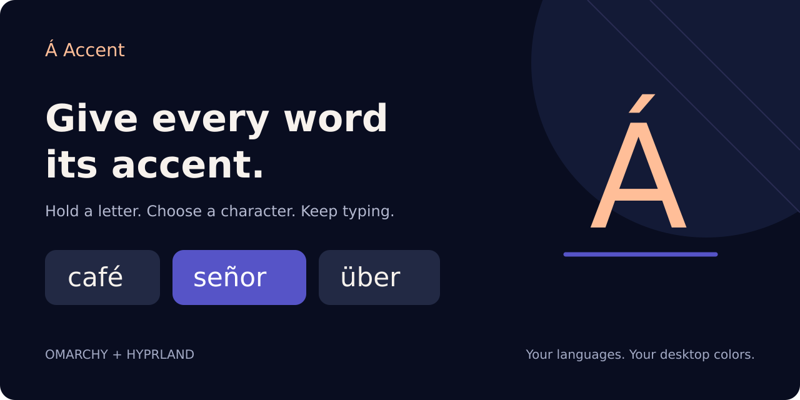
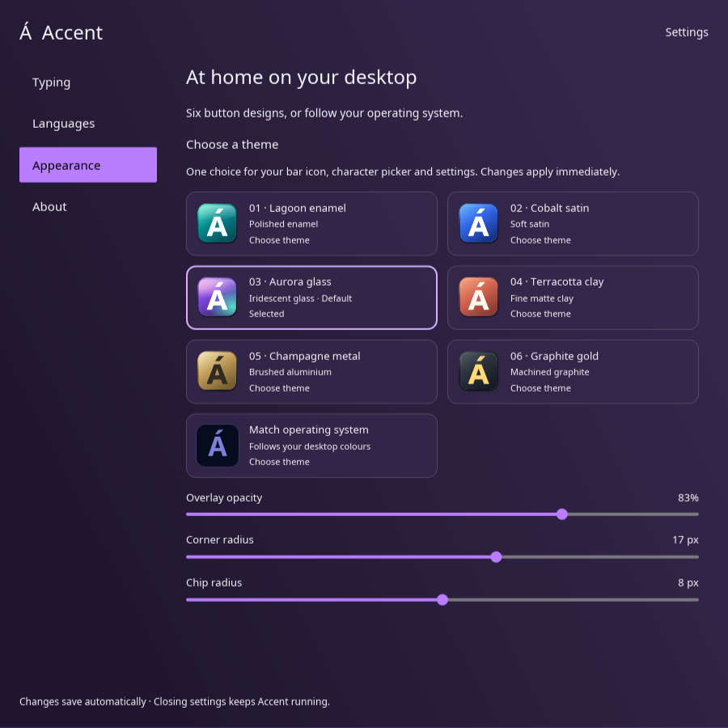

# Accent



**Accents and symbols, without breaking your flow.**

Write **café**, **señor**, and **über** with the letters already on your keyboard.
Hold a letter, choose its accent, and keep typing. Accent brings a configurable
character picker and bar controls to Omarchy. Choose from six coordinated button
themes, or match your operating system’s colours.

[Watch the demo](#see-it-in-action) · [Install](#install-on-omarchy) · [How it works](#use-it) · [Themes](#themes) · [Character sets](docs/CHARACTERS.md) · [Get help](https://github.com/BenLewies/Accent/issues)

## See it in action

Watch Accent turn a held letter into an accented character, then explore the typing
and language settings in this **89-second demo on Omarchy**.

[](assets/accent-demo.mp4?raw=true)

**[▶ Watch the full demo](assets/accent-demo.mp4?raw=true)** · Includes audio.

Hold a letter, choose an accent, and keep typing. The screenshot above is a cropped
frame from the recording; click it to open the full video.

### Theme picker



Choose a design in **Settings → Appearance**. The bar icon, character selector and
settings window share the choice; changes apply immediately and save automatically.

## Why Accent?

- **Hold, choose, release.** Long press alone or combine it with Space/arrow triggers.
- **Your languages, your picker.** Search language and symbol sets; keep only what you use.
- **Seven appearance choices.** Six button designs plus **Match operating system**; one choice for the bar icon, character picker and settings.
- **Stay in control.** Click **Á** for settings; right-click to pause, restart, or change startup.
- **Quiet by default.** Accent starts in the background. Settings open only on request.
- **Local processing.** No account, analytics, or keystroke logging in Accent.

## Install on Omarchy

Supported target: **Omarchy Quattro, Linux x86_64, with Hyprland**.
Review the repository, then use Omarchy’s standard installation:

```bash
omarchy plugin add https://github.com/BenLewies/Accent --enable
```

The repository includes the matching native runtime and its dependency notices.
Enabling the plugin starts it locally; disabling or removing the plugin releases
keyboard control. **No separate installer, Rust build, administrator prompt, input
group, device rules or reboot is required.** Enabling never downloads executable code.

Your typing and theme preferences are preserved. Existing installations made with
Accent’s old installer are moved from the old user service to plugin-owned startup.
The startup preference is retained. [Installation, migration and troubleshooting](docs/INSTALL.md).

Hyprland allows one input-method tool per seat. If Fcitx, IBus or another tool is
already using that interface, Accent reports the conflict and leaves that tool in
place. The standard installation target assumes no other active input method.
The marketplace’s curated **Manual Setup** label can change only after its
maintainers approve the updated listing; this release supplies the standard path.

## Use it

1. Click **Á** in the bar to open settings; select **Typing → Long press, Space and arrows**.
2. Hold a letter such as **e** until the picker appears (default delay: 250 ms).
3. Use Space or left/right arrows to select; release the letter to insert.
4. Press Escape to cancel, or Down to expand into a grid.

Changes save automatically. **Languages** filters available sets, **Appearance**
chooses the theme and controls picker shape and transparency, and **About** shows
provenance and privacy.
Closing settings leaves Accent running. The bar owns startup and shutdown; no
standalone service is needed.

## Themes

Open **Settings → Appearance** and choose a card:

| Option | Design | Finish |
| --- | --- | --- |
| 01 | Lagoon enamel | Teal gradient with polished enamel |
| 02 | Cobalt satin | Blue gradient with a satin finish |
| **03** | **Aurora glass — default** | **Violet, pink and cyan iridescence** |
| 04 | Terracotta clay | Warm coral with a fine matte texture |
| 05 | Champagne metal | Gold gradient with brushed aluminium |
| 06 | Graphite gold | Charcoal with a machined texture and gold Á |
| System | Match operating system | Your desktop’s current colours |

The **Á** mark stays visible in every design. The bar badge uses the selected
button artwork; the popup character selector and settings window use matching
surface, accent and selection colours. The choice is saved in
`~/.config/accent/config.toml` and survives restarts.


**Match operating system** follows Omarchy’s active background, foreground, accent
and selection colours live, including the bar badge. On other supported desktops,
it follows the system’s light/dark preference. Existing explicit theme settings
are retained; new configurations default to **03 — Aurora glass**.

To choose a theme by editing the configuration, set one of these values:

```toml
# Default: Aurora glass
theme = "aurora-glass"
# Other choices: lagoon-enamel, cobalt-satin, terracotta-clay,
# champagne-metal, graphite-gold, system
```

The runtime travels with the plugin, so a normal plugin update updates both.
See [Update & remove](#update--remove).

## Permissions, privacy & limits

The daemon uses Hyprland’s input-method and virtual-keyboard interfaces. It can
read and replace keyboard input within your desktop session, so install only code
you trust. It does not open physical keyboard devices or request administrator
access on this supported path. The widget runs in Omarchy’s unsandboxed shell.

Typing is processed locally, without accounts, analytics or keystroke logging.
Selected Unicode characters use a private virtual-keyboard keymap, including
characters from large language sets. This path does not use the clipboard or alter
your keyboard layout. Fields identified by applications as passwords, PINs or
sensitive input receive ordinary typing without the accent picker.
[Character sets](docs/CHARACTERS.md) · [Troubleshooting](docs/INSTALL.md#troubleshooting)

The supported listing target is **Omarchy Quattro on Linux x86_64 with Hyprland**.
macOS and other Linux desktops have inherited support, but are not covered by the
Omarchy listing or by local cross-platform validation. No claim of universal
application compatibility is made.

## Questions before installing

**Is this a keyboard layout?** Accent adds a character picker to your typing workflow.
Choose language sets in settings; you do not need to memorize compose sequences.

**Does adding the plugin install everything?** Yes. The matching runtime is included
in the repository and starts when the plugin is enabled.

**Can I pause it?** Right-click **Á** and pause the service. Start it again from the
same menu. Opening settings also starts the daemon if it is paused.

**Does it work in every app?** The new backend sends ordinary keyboard input to
Wayland and XWayland applications, including terminals. Application-specific
behaviour and conflicts with other input methods can still affect compatibility.

## Update & remove

Update the plugin and its bundled runtime together:

```bash
omarchy plugin update bjl.accent
```

Pause from the bar menu, or disable the plugin:

```bash
omarchy plugin disable bjl.accent
```

Remove it while retaining your preferences:

```bash
omarchy plugin remove bjl.accent
```

Settings remain in `~/.config/accent/` (or `$XDG_CONFIG_HOME/accent/`). Old installer
files and device rules are no longer used by the standard path; see
[legacy cleanup](docs/INSTALL.md#legacy-cleanup) before removing shared permissions.

## Source, support & attribution

Bug reports: [GitHub issues](https://github.com/BenLewies/Accent/issues).
Include desktop version, Accent version, trigger mode and a minimal reproduction;
never include typed passwords or private input. [Contributing](CONTRIBUTING.md) ·
[Security](SECURITY.md) · [Release preparation](docs/RELEASE_CHECKLIST.md)

Accent is an independent derivative of [QuickAccent by Victor Masson](https://github.com/victormasson/QuickAccent).
The original copyright and [MIT license](LICENSE) are retained. [NOTICE](NOTICE.md)
describes our changes; [third-party notices](THIRD_PARTY_NOTICES.md) cover mappings,
Unicode data, and vendored rdev. No upstream or marketplace endorsement is implied.
