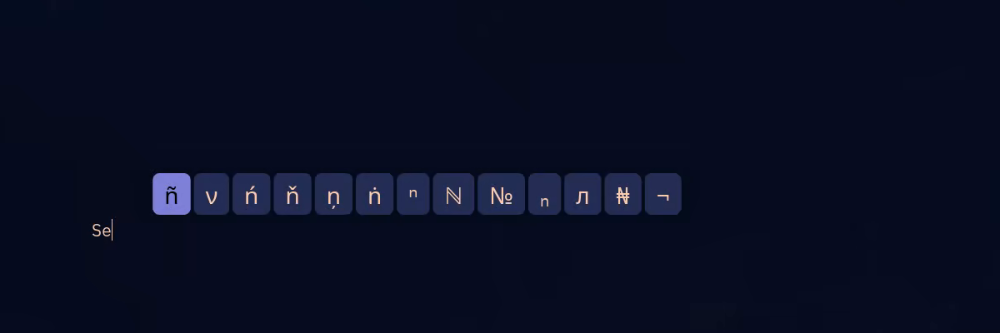
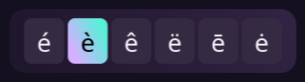

# Accent


**Accents and symbols, without breaking your flow.**

Write **café**, **señor**, and **über** with the letters already on your keyboard.
Hold a letter, choose its accent, and keep typing. Accent brings a configurable
character picker and bar controls to Omarchy. Choose from six coordinated button
themes, or match your operating system’s colours.

[Watch the demo](#see-it-in-action) · [Install](#install-on-omarchy) · [How it works](#use-it) · [Themes](#themes) · [Character sets](docs/CHARACTERS.md) · [Get help](https://github.com/BenLewies/Accent/issues)

## See it in action

Watch Accent turn a held letter into an accented character, then explore the typing
and language settings in this **89-second demo on Omarchy**.

[](assets/accent-demo.mp4?raw=true)

**[▶ Watch the full demo](assets/accent-demo.mp4?raw=true)** · Includes audio.

Hold a letter, choose an accent, and keep typing. The screenshot above is a cropped
frame from the recording; click it to open the full video.

### Theme picker


Choose a design in **Settings → Appearance**. The bar icon, character selector and
settings window share the choice; changes apply immediately and save automatically.

## Why Accent?

- **Hold, choose, release.** Long press alone or combine it with Space/arrow triggers.
- **Your languages, your picker.** Search language and symbol sets; keep only what you use.
- **Seven appearance choices.** Six button designs plus **Match operating system**; one choice for the bar icon, character picker and settings.
- **Stay in control.** Click **Á** for settings; right-click to pause, restart, or change startup.
- **Quiet by default.** The service starts in the background. Settings open only on request.
- **Local processing.** No account, analytics, or keystroke logging in Accent.

## Install on Omarchy

Supported target: **Omarchy Quattro, Linux x86_64, in an active local desktop
session**. Clone the release, review the source, then run its installer:

```bash
git clone --branch v1.4.1 --depth 1 https://github.com/BenLewies/Accent.git
cd Accent
./install.sh
```

This is the complete installation path. One installer handles:

- Required runtime packages through Omarchy’s package manager.
- The matching prebuilt program, checked against the release checksum and source commit.
- Keyboard and virtual-keyboard access for the active local session, with an administrator prompt when needed.
- The user service, automatic startup, launcher, icons and licence notices.
- The bar plugin, discovery and enablement.
- Final checks for device access, a responding daemon with a working virtual keyboard, automatic startup, the enabled bar plugin and matching versions.

You do **not** need Rust or a separate bar-plugin installation. The installer
preserves your preferences, backs up replaced files, and restores the previous
user installation if a later step fails. It does not add you to the `input` group;
the session-based device rules normally take effect immediately without a reboot.

Run it as your desktop user, without `sudo`. It explains the changes before
continuing; only package installation and device setup request administrator access.
For a source build, use `./install.sh --from-source`; it also installs build dependencies.
[Detailed installation, recovery and removal](docs/INSTALL.md).

Already installed the bar plugin from the marketplace? Run the complete installer
above to supply the runtime and permissions as well. A clean existing plugin is
upgraded with a backup; local Git changes must be committed or stashed first.
The marketplace’s **Manual Setup** label remains accurate: Omarchy’s plugin-add
command deliberately does not run installers or grant keyboard-device access.
Installing or enabling the widget never silently downloads code or requests privileges.

## Use it

1. Click **Á** in the bar to open settings; select **Typing → Long press, Space and arrows**.
2. Hold a letter such as **e** until the picker appears (default delay: 250 ms).
3. Use Space or left/right arrows to select; release the letter to insert.
4. Press Escape to cancel, or Down to expand into a grid.

Changes save automatically. **Languages** filters available sets, **Appearance**
chooses the theme and controls picker shape and transparency, and **About** shows
provenance and privacy.
Closing settings leaves the service running. `accent --settings` opens settings;
`accent --daemon` starts quietly.

## Themes

Open **Settings → Appearance** and choose a card:

| Option | Design | Finish |
| --- | --- | --- |
| 01 | Lagoon enamel | Teal gradient with polished enamel |
| 02 | Cobalt satin | Blue gradient with a satin finish |
| **03** | **Aurora glass — default** | **Violet, pink and cyan iridescence** |
| 04 | Terracotta clay | Warm coral with a fine matte texture |
| 05 | Champagne metal | Gold gradient with brushed aluminium |
| 06 | Graphite gold | Charcoal with a machined texture and gold Á |
| System | Match operating system | Your desktop’s current colours |

The **Á** mark stays visible in every design. The bar badge uses the selected
button artwork; the popup character selector and settings window use matching
surface, accent and selection colours. The choice is saved in
`~/.config/accent/config.toml` and survives restarts.



**Match operating system** follows Omarchy’s active background, foreground, accent
and selection colours live, including the bar badge. On other supported desktops,
it follows the system’s light/dark preference. Existing explicit theme settings
are retained; new configurations default to **03 — Aurora glass**.

To choose a theme by editing the configuration, set one of these values:

```toml
# Default: Aurora glass
theme = "aurora-glass"
# Other choices: lagoon-enamel, cobalt-satin, terracotta-clay,
# champagne-metal, graphite-gold, system
```

Use the complete installer when upgrading so the bar plugin and background
program stay on the same release. See [Update & remove](#update--remove).

## Permissions, privacy & limits

The daemon reads keyboard devices and injects selected characters through uinput.
Membership of `input` permits reading all keyboards: install only code you trust.
The QML bar plugin manages only the **user** service and calls the settings CLI.
It never requests privilege or edits unrelated desktop configuration.

Typing is processed locally. Some characters use a clipboard fallback, which can
replace clipboard content. Too many enabled language sets exceed the custom
keymap capacity; overflow characters may not work in terminals. Start with only
the languages you need. [Character sets](docs/CHARACTERS.md) · [Troubleshooting](docs/INSTALL.md#troubleshooting)

The supported listing target is **Omarchy Quattro on Linux x86_64 with Hyprland**.
macOS and other Linux desktops have inherited support, but are not covered by the
Omarchy listing or by local cross-platform validation. No claim of universal
application compatibility is made.

## Questions before installing

**Is this a keyboard layout?** Accent adds a character picker to your typing workflow.
Choose language sets in settings; you do not need to memorize compose sequences.

**Does adding the plugin install everything?** There are two parts: the Omarchy bar
plugin and the Accent daemon. Install the daemon once using the instructions above;
the bar then provides settings and service controls.

**Can I pause it?** Right-click **Á** and pause the service. Start it again from the
same menu. Opening settings also starts the daemon if it is paused.

**Does it work in every app?** Compatibility depends on the application and character.
Clipboard fallback and terminal limitations are described above.

## Update & remove

For an update, check out the new release in your original Accent clone and rerun
`./install.sh`. It upgrades both the program and bar plugin, restarts the service,
and checks the result. Running the same release again also repairs an incomplete
installation. Your settings in `~/.config/accent/config.toml` are retained.

Check an installation without changing it:

```bash
./install.sh --check
```

The command reports each readiness check and exits unsuccessfully if any is missing.
Updating only the bar through `omarchy plugin update bjl.accent` does not update
the native program; use the release installer for complete upgrades.

To remove the user installation while keeping preferences:

```bash
systemctl --user disable --now accent.service
omarchy plugin remove bjl.accent
rm -f ~/.local/bin/accent ~/.local/share/applications/accent.desktop
rm -f ~/.config/systemd/user/accent.service
systemctl --user daemon-reload
```

See [complete removal](docs/INSTALL.md#removal) for icons, notices, backups and
administrator-owned device rules. Existing input-group membership from older
installations is preserved; do not remove it if another application needs it.

## Source, support & attribution

Bug reports: [GitHub issues](https://github.com/BenLewies/Accent/issues).
Include desktop version, Accent version, trigger mode and a minimal reproduction;
never include typed passwords or private input. [Contributing](CONTRIBUTING.md) ·
[Security](SECURITY.md) · [Release preparation](docs/RELEASE_CHECKLIST.md)

Accent is an independent derivative of [QuickAccent by Victor Masson](https://github.com/victormasson/QuickAccent).
The original copyright and [MIT license](LICENSE) are retained. [NOTICE](NOTICE.md)
describes our changes; [third-party notices](THIRD_PARTY_NOTICES.md) cover mappings,
Unicode data, and vendored rdev. No upstream or marketplace endorsement is implied.
