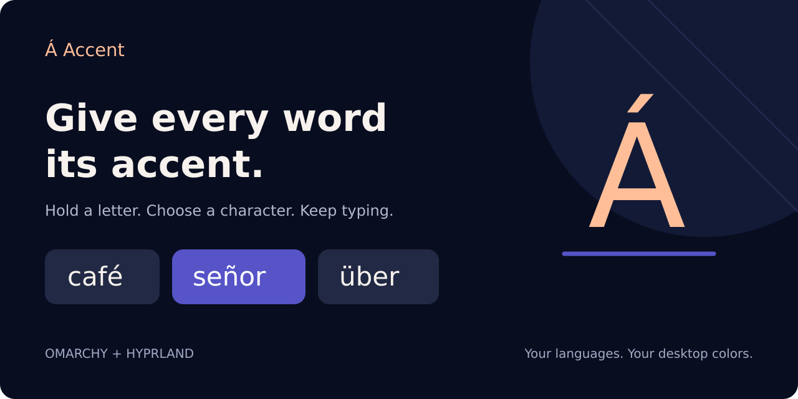
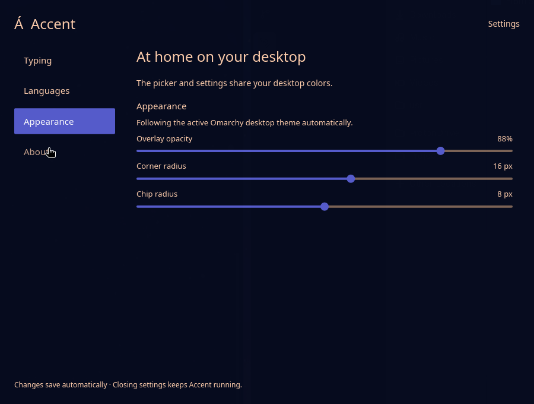

# Accent



**Accents and symbols, without breaking your flow.**

Write **café**, **señor**, and **über** with the letters already on your keyboard.
Hold a letter, choose its accent, and keep typing. Accent brings a configurable
character picker and bar controls to Omarchy, with colors that follow your desktop.

[Install](#install-on-omarchy) · [How it works](#use-it) · [Character sets](docs/CHARACTERS.md) · [Get help](https://github.com/BenLewies/Accent/issues)

<details>
<summary>See Accent’s theme-aware settings</summary>



</details>

## Why Accent?

- **Hold, choose, release.** Long press alone or combine it with Space/arrow triggers.
- **Your languages, your picker.** Search language and symbol sets; keep only what you use.
- **A natural fit.** Picker, settings, and bar controls follow the active Omarchy colors.
- **Stay in control.** Click **Á** for settings; right-click to pause, restart, or change startup.
- **Quiet by default.** The service starts in the background. Settings open only on request.
- **Local processing.** No account, analytics, or keystroke logging in Accent.

## Install on Omarchy

**Publication status:** this repository is being prepared for public release and
marketplace review. It is not currently listed or verified. The GitHub plugin-add
command below becomes available to everyone when the repository is made public.

```bash
omarchy plugin add https://github.com/BenLewies/Accent --enable
```

The bar plugin requires the Accent daemon. It does **not** silently download,
compile, or install privileged software. Until an Accent release is published,
install from the reviewed source already cloned by the command above:

```bash
cd ~/.config/omarchy/plugins/bjl.accent
INSTALL_FROM_SOURCE=1 ./dist/linux/install.sh
```

Requires a Rust toolchain, a C compiler, pkg-config, and development libraries
for X11/XInput/XTest, Wayland, xkbcommon, fontconfig, ALSA and graphics. On Arch,
these come from the corresponding system packages; see [installation details](docs/INSTALL.md).
The installer requests elevation for input-device rules/module setup and adds
your user to the `input` group if necessary. A new login session or reboot may be
needed for group changes. It installs a per-user service and launcher.

Already have Accent? Add the bar plugin and use it immediately. The default
plugin ID remains `bjl.accent` so existing installations retain their settings.

## Use it

1. Click **Á** in the bar to open settings; select **Typing → Long press, Space and arrows**.
2. Hold a letter such as **e** until the picker appears (default delay: 250 ms).
3. Use Space or left/right arrows to select; release the letter to insert.
4. Press Escape to cancel, or Down to expand into a grid.

Changes save automatically. **Languages** filters available sets, **Appearance**
controls picker shape and transparency, and **About** shows provenance and privacy.
Closing settings leaves the service running. `accent --settings` opens settings;
`accent --daemon` starts quietly.

## Permissions, privacy & limits

The daemon reads keyboard devices and injects selected characters through uinput.
Membership of `input` permits reading all keyboards: install only code you trust.
The QML bar plugin manages only the **user** service and calls the settings CLI.
It never requests privilege or edits unrelated desktop configuration.

Typing is processed locally. Some characters use a clipboard fallback, which can
replace clipboard content. Too many enabled language sets exceed the custom
keymap capacity; overflow characters may not work in terminals. Start with only
the languages you need. [Character sets](docs/CHARACTERS.md) · [Troubleshooting](docs/INSTALL.md#troubleshooting)

The supported listing target is **Omarchy Quattro on Linux x86_64 with Hyprland**.
macOS and other Linux desktops have inherited support, but are not covered by the
Omarchy listing or by local cross-platform validation. No claim of universal
application compatibility is made.

## Questions before installing

**Is this a keyboard layout?** Accent adds a character picker to your typing workflow.
Choose language sets in settings; you do not need to memorize compose sequences.

**Does adding the plugin install everything?** There are two parts: the Omarchy bar
plugin and the Accent daemon. Install the daemon once using the instructions above;
the bar then provides settings and service controls.

**Can I pause it?** Right-click **Á** and pause the service. Start it again from the
same menu. Opening settings also starts the daemon if it is paused.

**Does it work in every app?** Compatibility depends on the application and character.
Clipboard fallback and terminal limitations are described above.

## Update & remove

Update the plugin using `omarchy plugin update bjl.accent`. When the daemon source
changes, review it and rerun the source installer, then `systemctl --user restart accent`.
User settings live in `~/.config/accent/config.toml` and are retained.

```bash
omarchy plugin disable bjl.accent
omarchy plugin remove bjl.accent
systemctl --user disable --now accent.service
rm -f ~/.local/bin/accent ~/.local/share/applications/accent.desktop
rm -f ~/.config/systemd/user/accent.service
systemctl --user daemon-reload
```

These commands retain settings and license notices. See [complete removal](docs/INSTALL.md#removal)
for optional icons, renderer override, and device-rule cleanup. Never remove your
`input` group membership if another application needs it.

## Source, support & attribution

Bug reports: [GitHub issues](https://github.com/BenLewies/Accent/issues).
Include desktop version, Accent version, trigger mode and a minimal reproduction;
never include typed passwords or private input. [Contributing](CONTRIBUTING.md) ·
[Security](SECURITY.md) · [Release preparation](docs/RELEASE_CHECKLIST.md)

Accent is an independent derivative of [QuickAccent by Victor Masson](https://github.com/victormasson/QuickAccent).
The original copyright and [MIT license](LICENSE) are retained. [NOTICE](NOTICE.md)
describes our changes; [third-party notices](THIRD_PARTY_NOTICES.md) cover mappings,
Unicode data, and vendored rdev. No upstream or marketplace endorsement is implied.
